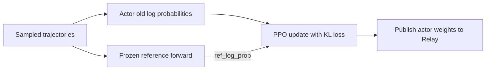

# Reference-policy KL loss

Async training supports a frozen reference model through verl's PPO KL loss:

```bash
bash recipes/swe/train.sh \
  actor_rollout_ref.actor.use_kl_loss=True \
  actor_rollout_ref.actor.kl_loss_coef=0.001 \
  actor_rollout_ref.actor.kl_loss_type=low_var_kl \
  actor_rollout_ref.ref.megatron.param_offload=True
```

The default remains `use_kl_loss=False`, which creates no reference model and
makes no reference forward calls. With KL enabled, the `actor_ref` worker owns
two independent models on the existing trainer GPU pool. The reference loads
the original `actor_rollout_ref.model.path`; actor updates and Relay weight
publication affect only the actor. No verl or uni-agent changes are required.



Reference inference uses its own dispatch mesh. Response probabilities align
with the sampled response window; padding and tool tokens are excluded by the
action mask. The existing verl `kl_loss` and `kl_coef` metrics are retained;
Laminar adds only `timing/ref_log_prob`.

Actor and reference must use the same strategy and parallel topology. Megatron
TP/PP/CP/EP, dynamic CP and bridge settings must match; reference defaults
inherit the actor topology. Reference microbatch and token limits remain
independently configurable under `actor_rollout_ref.ref.log_prob_*`.
Pinned verl automatically offloads forward-only FSDP reference models to CPU.
Megatron requires `actor_rollout_ref.ref.megatron.param_offload=True` for
`colocate_async`. The reference adds model storage and a
forward pass; size the trainer pool accordingly.

The first implementation supports full-model actors and KL in the loss.
`algorithm.use_kl_in_reward=True` and LoRA actors with KL enabled are rejected.

Checkpoints save the actor and prompt cursor plus `reference_policy.json`.
The reference is rebuilt from the original model path on resume, before actor
state is restored. Resume validates the path, rank topology and a SHA-256
digest of the first and last 64 elements of each local parameter shard.
This sampled digest is an identity check, not a full-weight checksum.
Keep the original model files immutable and resume with the same trainer
topology. A legacy checkpoint without the reference sidecar cannot resume
with KL enabled, and a KL checkpoint cannot silently resume with KL disabled.

Run the focused CPU tests with the project's test environment. A free CUDA GPU
can also run three real FSDP2 updates and a save/rebuild/restore check using a
locally generated tiny model:

```bash
pytest -q tests/test_reference_policy_on_cpu.py
RUN_REFERENCE_GPU_TESTS=1 CUDA_VISIBLE_DEVICES=0 pytest -q tests/test_reference_policy_on_gpu.py
```
