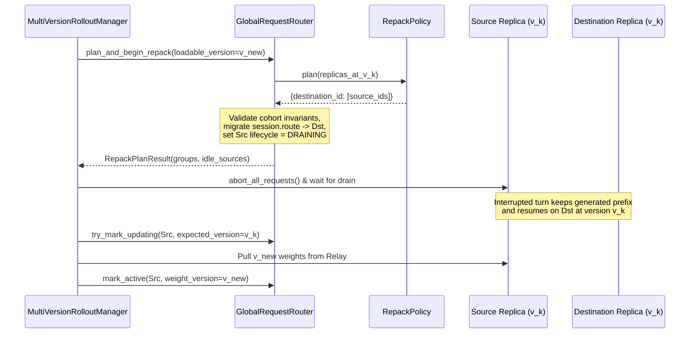

# Same-Version Repack (`laminar.multi_version_rollout`)

Under `rollout_router.continuation=same_version` (and across queued checkpoints in `laminar.eval`), each sticky session stays pinned to its initial `weight_version`. As most trajectories finish, a few long-horizon tail sessions can hold multiple stale replicas open at low utilization. **Repack** consolidates those remaining same-version sessions onto fewer destination replicas so drained source replicas can immediately reload newer weights.

## 1. Repack Workflow



1. **Synchronous Cohort Snapshot (`GlobalRequestRouter`):** When newer weights are available (`weight_version < loadable_version`), the Router groups healthy `ACTIVE` stale replicas by `weight_version` from one synchronous routing snapshot and exports read-only `RepackReplica` / `RepackSession` views (`context_tokens`, `inflight_leases`, `kv_cache_usage`, queue counts) to `self._repack_policy.plan(replicas)`.
2. **Invariant Validation & Atomic Route Commit:** Before mutating any state, `_commit_repack_groups` verifies that the returned `destination -> sources` mapping is non-empty, duplicate-free, disjoint across groups, confined to the eligible version cohort, and only migrates sources with bound sessions. Passing groups atomically rebind future session turns to `destination` and mark `sources` as `DRAINING` (already-drained stale replicas bypass `RepackPolicy` and transition directly to `UPDATING`).
3. **Graceful Prefix Continuation:** `MultiVersionRolloutManager` (or `laminar.eval`) aborts in-flight backend generations on each `DRAINING` source. `LLMServerClient` retains already generated tokens for any interrupted turn and acquires its next lease on the new `destination` replica at the exact same `weight_version`.
4. **Weight Reload & Reopen:** Once all leases and backend requests on a source settle, `try_mark_updating` fences the replica, the manager loads the new weights, and `mark_active` reopens the replica at the new version.

## 2. Default Algorithm: `BestFitRepackPolicy`

By default, both training (`multi_version_rollout.repack.policy`) and evaluation (`validation.repack.policy`) use `BestFitRepackPolicy`, which implements **Best-Fit Decreasing (BFD)** over instantaneous backend KV-cache utilization:

1. **Fail-Fast KV Check:** Verify every replica in the cohort reports a finite `kv_cache_usage` in `[0, 1]`.
2. **Decreasing Source Order:** Select replicas with at least one bound session and `kv_cache_usage <= source_max_kv_cache_usage` (default `0.5`), sorted by `(-kv_cache_usage, server_id)` so larger movable workloads are placed first.
3. **Best-Fit Destination Selection:** For each source, pick the remaining candidate destination (excluding replicas already chosen as sources) with `destination_kv <= destination_max_kv_cache_usage` whose projected load `destination_kv + source_kv <= destination_max_kv_cache_usage` (default `0.95`) is **highest** (tightest fit, breaking ties by ascending `server_id`), then update the destination's projected KV usage.

Default configuration (`src/laminar/train/config/async_rl_base.yaml`):

```yaml
multi_version_rollout:
  repack:
    enable: True
    policy:
      _target_: laminar.multi_version_rollout.BestFitRepackPolicy
      source_max_kv_cache_usage: 0.5
      destination_max_kv_cache_usage: 0.95
```

## 3. Custom Policy Example: Phase-Aware Time-Decayed Load Proxy

In multi-turn tool-using agents (e.g., SWE), many bound sessions sit idle off-GPU waiting on sandbox execution. Instantaneous backend `kv_cache_usage` can drop near `0` during tool waits, yet sessions that just entered a tool call are likely to resume shortly and reclaim KV blocks for their full `context_tokens`.

`GlobalRequestRouter` owns one `RepackPolicy` instance across passes, allowing a custom policy to combine `RepackSession` phase (`inflight_leases > 0` vs. tool-waiting `inflight_leases == 0`), `context_tokens`, and cross-pass idle duration into a **ThunderAgent-style time-decayed KV proxy**:

- **Active generation (`inflight_leases > 0`):** reserve `context_tokens + decode_reserve_tokens`.
- **Tool-waiting (`inflight_leases == 0`):** decay expected token demand by $2^{-\Delta t / T_{1/2}}$ over the time $\Delta t$ spent off-GPU, bounded below by live `kv_cache_usage`.

```python
import time
from collections.abc import Callable, Mapping, Sequence

from laminar.multi_version_rollout import RepackPolicy, RepackReplica


class DecayedTokenProxyPolicy(RepackPolicy):
    """BFD Repack policy using a phase-aware, time-decayed token load proxy."""

    def __init__(
        self,
        token_capacity: int,
        *,
        source_max_proxy: float = 0.5,
        destination_max_proxy: float = 0.95,
        half_life_s: float = 30.0,
        decode_reserve_tokens: int = 256,
        monotonic_fn: Callable[[], float] = time.monotonic,
    ) -> None:
        self.token_capacity = token_capacity
        self.source_max_proxy = source_max_proxy
        self.destination_max_proxy = destination_max_proxy
        self.half_life_s = half_life_s
        self.decode_reserve_tokens = decode_reserve_tokens
        self._monotonic = monotonic_fn
        # Keyed by (weight_version, session_id) across Repack passes.
        self._idle_since: dict[tuple[int, str], float] = {}

    def _session_proxy_tokens(self, version: int, replica: RepackReplica, now_s: float) -> float:
        total = 0.0
        for session in replica.sessions:
            key = (version, session.session_id)
            if session.inflight_leases > 0:
                self._idle_since.pop(key, None)
                total += session.context_tokens + self.decode_reserve_tokens
            else:
                idle_s = max(0.0, now_s - self._idle_since.setdefault(key, now_s))
                total += session.context_tokens * (0.5 ** (idle_s / self.half_life_s))
        return total

    def plan(self, replicas: Sequence[RepackReplica]) -> Mapping[str, Sequence[str]]:
        if not replicas:
            return {}
        now_s = float(self._monotonic())
        version = replicas[0].weight_version
        live_keys = {(version, s.session_id) for r in replicas for s in r.sessions}
        for key in [k for k in self._idle_since if k[0] == version and k not in live_keys]:
            del self._idle_since[key]

        if len(replicas) < 2:
            return {}

        proxy_load = {
            r.server_id: max(
                float(r.kv_cache_usage or 0.0),
                self._session_proxy_tokens(version, r, now_s) / self.token_capacity,
            )
            for r in replicas
        }
        sources = sorted(
            (
                (proxy_load[r.server_id], r.server_id)
                for r in replicas
                if r.sessions and proxy_load[r.server_id] <= self.source_max_proxy
            ),
            key=lambda item: (-item[0], item[1]),
        )

        planned_sources: dict[str, list[str]] = {}
        projected_load = dict(proxy_load)
        for src_load, src_id in sources:
            if src_id not in projected_load or src_id in planned_sources:
                continue
            best_fit: tuple[float, str] | None = None
            for dst_id, dst_load in projected_load.items():
                if dst_id == src_id or dst_load > self.destination_max_proxy:
                    continue
                merged = dst_load + src_load
                if merged <= self.destination_max_proxy and (
                    best_fit is None or merged > best_fit[0] or (merged == best_fit[0] and dst_id < best_fit[1])
                ):
                    best_fit = (merged, dst_id)
            if best_fit is None:
                continue
            merged, dst_id = best_fit
            del projected_load[src_id]
            planned_sources.setdefault(dst_id, []).append(src_id)
            projected_load[dst_id] = merged

        return {dst_id: tuple(planned_sources[dst_id]) for dst_id in sorted(planned_sources)}
```

Enable a custom policy via Hydra `_target_` override (using `~` to replace the default `BestFitRepackPolicy` mapping cleanly):

```bash
python -m laminar.train \
  ~multi_version_rollout.repack.policy \
  +multi_version_rollout.repack.policy._target_=my_pkg.repack.DecayedTokenProxyPolicy \
  +multi_version_rollout.repack.policy.token_capacity=131072 \
  +multi_version_rollout.repack.policy.half_life_s=30.0
```
