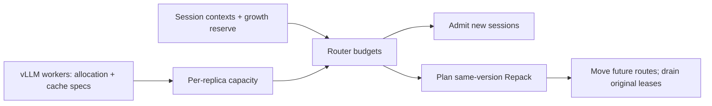

# Per-replica session admission and logical KV Repack

The default strategy retains the AgentLoop's total session limit, the optional
dispatcher gate based on observed `kv_cache_usage`, and snapshot-based Repack.
Enable the alternative Router strategy with:

```bash
laminar ... rollout_router.logical_kv.enabled=True
```

This supplements the existing total session limit. Each replica admits at most
`max_sessions_per_replica` sessions and must have room for their estimated KV
demand. Bound sessions continue to count while waiting on tools, even when they
have no request lease. Retries do not consume another slot. Closing the session
through `release_route` releases its budget.



For each replica the Router sums:

```text
logical_kv_bytes =
    bytes_per_token * (context_tokens + reserved_tokens)
    + bytes_per_state * state_count
```

Shared prefixes are counted once per live context; the estimate does not subtract
shared prefix-cache blocks. Sharing can reduce the blocks actually used by these
contexts, while the preallocated GPU KV pool keeps its size. Conversely, vLLM may
retain cached prefixes from closed sessions. Logical demand and observed cache
usage therefore need not match or have a fixed ordering.

The worker coefficients come from vLLM's initialized cache specs and deduplicated
backing storage, including attention, Mamba cache modes and decode context
parallelism. Replica capacity uses the most constrained worker ratios so that
pipeline/tensor parallel imbalance does not silently overstate capacity. Evidence
is captured before colocated engines sleep; enabling the policy without capacity
for every replica fails initialization.

| Setting under `rollout_router.logical_kv` | Default | Purpose |
| --- | --- | --- |
| `enabled` | `False` | Select logical admission and Repack planning |
| `max_sessions_per_replica` | `24` | New-session cap at every KV demand |
| `admission_capacity_multiplier` | `1.2` | Maximum estimated demand for a new bind, relative to physical capacity |
| `growth_tokens_per_state` | `512` | Reserve future tokens per independent context |
| `repack_capacity_multiplier` | `1.0` | Maximum combined demand after Repack |
| `repack_session_multiplier` | `1.5` | Allow up to 36 sessions after Repack with the default admission cap |
| `repack_max_waiting_requests` | `32` | Combined scheduler waiting / committed-lease bound |

Placement balances estimated demand among active replicas satisfying the minimum
weight version. Under `latest_version` it uses only the newest routable cohort.
Repack combines only active, available replicas of the same stale weight version,
recomputes source demand using the destination's coefficients, and checks cumulative
session, KV and request limits. The existing lease ownership, abort, drain and
weight-loading protocol remains responsible for executing the plan.

The snapshot thresholds in `dynamic_overload_admission` and
`multi_version_rollout.repack` govern the default strategy. With logical admission
enabled, the dispatcher lets the Router control admission and the logical budget
replaces the snapshot-based Repack thresholds. `get_budget_snapshot()` exposes
both estimated demand and observed `kv_cache_usage` for inspection.

The client updates a single-context session's budget from prompt and returned
token lengths. An owner with multiple independent contexts must call
`LLMServerClient.update_session_budget(session_id, context_tokens=..., state_count=...,
revision=...)` with absolute totals, including all live contexts, and pass
`budget_managed=True` to generation so per-request accounting does not overwrite
them. Revisions increase per session; stale updates are ignored. The currently
pinned Uni-Agent does not automatically publish these multi-context totals.

Already admitted sessions may grow beyond admission limits and must continue to
completion, including after latest-version rebinding. Their updated demand blocks
new admissions and additional Repack consolidation until they close. Physical KV
allocation, preemption and recomputation remain vLLM's responsibility: this is a
logical demand estimate, not measured GPU occupancy or an OOM guarantee. Startup
capacity assumes a stable cache layout/allocation for the replica lifetime;
capacity changes after backend recovery are not requalified by this policy.
