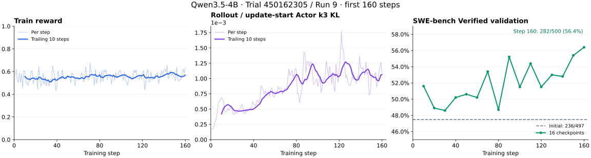

# Qwen3.5-4B SWE: Trial 450162305 / Run 9

This record covers training steps 1–160 and the 16 checkpoints saved at steps
10–160. Step 160 resolves **282/500 SWE-bench Verified instances (56.4%)**.
The initial model resolves 236/497 scored instances (47.48%); three of the
500 initial evaluation instances have no recorded score.

The public [training launcher](train_qwen35_4b_run9.sh) requires
[PR #1: reference-policy KL loss](https://github.com/verl-project/laminar/pull/1).
Actor and Ref share the 32-GPU training pool. Ref starts from the same
Qwen3.5-4B model as Actor and remains frozen, with forward passes only.

## Training configuration

The tables summarize the recorded Run 9 model, objective, batching and resource
settings. The launcher uses the public configuration schema, configurable
model/data/output paths, and the shared [SWE agent task recipe](task_config.yaml).
Set `TRAIN_FILE` to the SWE-rebench parquet used for your experiment; the
historical training file was a filtered SWE-rebench subset named
`swe_rebench_filtered_1150.parquet`.

| Component | Run 9 setting |
| --- | --- |
| Model | Qwen3.5-4B, BF16 |
| GPU layout | 10 nodes × 8 A100 GPUs: 4 training nodes + 6 rollout nodes |
| Training strategy | `separate_async` |
| Actor parallelism | Megatron TP1 / PP1 / CP4 / EP1 / ETP1, DP8 |
| Ref parallelism | Megatron TP1 / PP1 / CP4 / EP1 / ETP1, DP8, on the Actor pool |
| Model execution | Megatron-Bridge; Flash Attention; remove padding and Triton fused kernels enabled |
| Actor recomputation | Full / uniform / 1 layer |
| Compilation | Actor and Ref `use_torch_compile=True`; `TORCHINDUCTOR_QUIESCE_ASYNC_COMPILE_POOL=0` propagated to Ray workers |
| Activation offload | Disabled |
| Actor offload | Parameters and optimizer offloaded to CPU |
| CPU optimizer | Offload fraction 1.0; CPU optimizer, overlapped CPU transfers and precision-aware optimizer enabled |
| Ref execution | `param_offload=True`, `optimizer_offload=False`, `forward_only=True`; no optimizer updates |
| Prompt / response limit | 8,192 / 131,072 tokens; maximum model length 139,264 |
| Train batch | 32 prompts × 8 trajectories = 256 trajectories per training step |
| PPO mini batch | 16 prompts × 8 = 128 trajectories; 2 sequential mini-batch optimizer updates per training step; 1 PPO epoch; no mini-batch shuffle |
| Dynamic batching | Enabled; Actor and Ref token budgets 34,816 per GPU; micro batch 1 per GPU |
| Input filtering | Filter overlong prompts; truncation mode `error`; generation batch 1 prompt |

| Objective / optimizer | Run 9 setting |
| --- | --- |
| Advantage | GRPO; normalize advantages by group standard deviation |
| Policy loss | PPO `vanilla`; clip low 0.2 / high 0.28; dual-clip constant 10 |
| Loss aggregation | `seq-mean-token-mean`; scale factor 1.0 |
| Ref KL loss | Enabled; coefficient 0.001; `low_var_kl` |
| KL in reward | Disabled |
| Entropy coefficient | 0 |
| Rollout importance correction | Token-level importance sampling; cap 2.0; no batch normalization or rejection sampling |
| Reward group filtering | Enabled on `reward`; `max_num_gen_batches=0`, `max_inflight_gen_batches=1` |
| Optimizer | Adam; learning rate 1e-6; constant schedule; no warmup |
| Optimizer parameters | Weight decay 0.1; betas (0.9, 0.98); gradient clipping 1.0 |

| Rollout / checkpointing | Run 9 setting |
| --- | --- |
| Rollout engine | vLLM, asynchronous, 48 TP1 replicas |
| Training sampling | Temperature 1.0; top-p 1.0; top-k -1; 8 samples per prompt |
| vLLM limits | `max_num_seqs=1024`, `max_num_batched_tokens=32768`, GPU memory utilization 0.9 |
| vLLM execution | Chunked prefill and prefix caching enabled; sleep mode enabled; eager execution disabled; `mamba_cache_mode=align` |
| Rollout log probabilities | Enabled; dynamic token budget 34,816 per GPU |
| Agent integration | Uni-Agent ReAct; Qwen tool format; 48 gateways; Ray task dispatch |
| Runner session limit | `max_concurrent_sessions=0` (no static runner cap) |
| Experience buffer | FIFO; capacity 4,096 |
| Dispatch / admission | 1-second dispatch interval; snapshot KV admission enabled at 0.80 |
| Weight publication | Every training step |
| Checkpoints | Every 10 steps; retain all Actor checkpoints; resume mode disabled |
| Documented window | Steps 1–160; the public launcher defaults to 160 steps |

Run 9 has no configured training-step limit in its saved configuration.
The launcher's 160-step limit selects the window reported here. Its scheduler
and admission configuration follows the public base recipe; the historical
runtime also used custom logical admission code outside PR #1. The historical
measurements have not been reproduced by running this public launcher.
The reward-group filtering flags preserve the saved Run 9 configuration;
the public async trainer at PR #1 does not consume `algorithm.filter_groups`,
so those flags alone do not reproduce historical reward-group filtering.

## Launch

Use the shared cluster, persistent storage and sandbox setup described in the
[SWE README](README.md#prerequisites), with the 80-GPU allocation above and
PR #1 included in your checkout.

```bash
export MODEL_PATH=/shared/models/Qwen3.5-4B
export TRAIN_FILE=/shared/data/swe/swe_rebench_filtered_1150.parquet
export RAY_DATA_HOME=/shared/outputs/qwen35-4b-swe-run9
export PERSISTENT_OUTPUT_ROOT=/shared/outputs
export TASK_CONFIG_PATH="$PWD/recipes/swe/task_config.yaml"
export RAY_ADDRESS=auto

uv run --locked --extra megatron --extra vllm --extra ucx --extra swe \
  bash recipes/swe/train_qwen35_4b_run9.sh
```

Hydra arguments passed to the script override its defaults. For a short launch
check, append `trainer.total_training_steps=3 trainer.save_freq=3`.

## Training and validation results



The figure places all three panels in one horizontal row. The SVG contains
vector paths and text, is serialized on one physical line, and includes no
embedded raster image. Training panels show every step and a trailing
10-step mean, beginning at step 10.

The [training CSV](qwen35_4b_run9_train.csv) contains all 160 values of
`train_batch/rewards/mean` and `rollout_corr/k3_kl`, plus the reward count and
`actor/kl_loss`. The reward series uses the Trial 450162305 / Run 9 history
shown in `trial-450162305-reward-histories-20261120.png`; the KL series uses
the data behind `trial-450162305-run9-k3-kl-20261119.png`.

| Training metric | Steps 1–160 |
| --- | ---: |
| Recorded steps | 160 |
| Rewards per step | 256 |
| Mean train reward across steps | 0.5535888671875 |
| Train reward at step 160 | 0.6328125 |
| `rollout_corr/k3_kl` at step 160 | 0.001095049548894167 |
| Maximum `rollout_corr/k3_kl` | 0.0017751255072653294 |

`rollout_corr/k3_kl` measures the difference between the behavior/rollout
policy and the Actor policy at the start of an update. The k3 estimator
averages `r - log(r) - 1`, where
`r = exp(actor_log_prob - rollout_log_prob)`, over response tokens.
Ref regularization is recorded separately as `actor/kl_loss`; the k3 curve
does not measure drift from the frozen Ref.

## Validation of all 16 checkpoints

The checkpoint aggregates and initial-model aggregate are the data behind
`score_trend_more.svg`, restricted to steps 10–160. Evaluation targets the
500-instance SWE-bench Verified set with one trajectory per instance (`n=1`).
The reported rate matches the recorded `mean_rm_score`: resolved instances
divided by **scored sessions**. Unscored instances are listed explicitly.

| Checkpoint step | Resolved / scored | Recorded resolved rate | Unscored of 500 |
| --- | ---: | ---: | ---: |
| Initial model | 236/497 | 47.48% | 3 |
| 10 | 257/498 | 51.61% | 2 |
| 20 | 244/499 | 48.90% | 1 |
| 30 | 242/498 | 48.59% | 2 |
| 40 | 251/500 | 50.20% | 0 |
| 50 | 251/496 | 50.60% | 4 |
| 60 | 250/498 | 50.20% | 2 |
| 70 | 267/500 | 53.40% | 0 |
| 80 | 243/499 | 48.70% | 1 |
| 90 | 275/498 | 55.22% | 2 |
| 100 | 257/499 | 51.50% | 1 |
| 110 | 272/500 | 54.40% | 0 |
| 120 | 257/499 | 51.50% | 1 |
| 130 | 265/500 | 53.00% | 0 |
| 140 | 264/500 | 52.80% | 0 |
| 150 | 277/500 | 55.40% | 0 |
| **160** | **282/500** | **56.40%** | **0** |

Step 160 is the highest recorded resolved rate in this 16-checkpoint window.
The initial-model and step-160 rates differ by 8.92 percentage points, with
the different score coverage shown above. The
[validation CSV](qwen35_4b_run9_validation.csv) preserves the counts and
unrounded rates. Rebuild the figure from the two adjacent CSVs with
`python recipes/swe/plot_qwen35_4b_run9.py` (requires Matplotlib).
